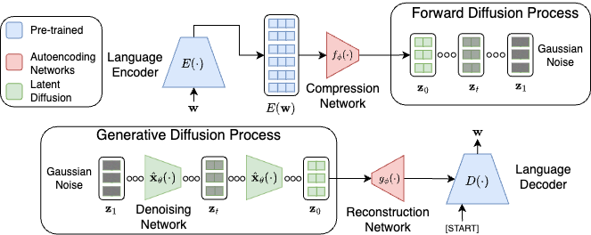

# Representation-centred latent diffusion for Afrikaans

Research fork maintained by **Hadi Butt**, based on Lovelace et al.'s
*Latent Diffusion for Language Generation* (NeurIPS 2023). English ROCStories/BART
experiments provide implementation controls; Afrikaans NCHLT/mT5 experiments are
the main study. A Swahili run of the same pipeline is checked descriptively. Upstream attribution
and usage examples are preserved below.

## Current research status

- The Afrikaans benchmark contains five training seeds for each of two diffusion
  configurations, using one frozen adapted mT5 autoencoder. Mean external mGPT
  test-generation perplexity is 51.31 (small) and 48.61 (large). These scores do
  not establish linguistic quality or an isolated equal-compute capacity effect.
- The trained AR comparison is validation-only and qualified by different
  pretraining, compute, data exposure and decoding. It is not a fully matched
  diffusion-versus-AR experiment.
- Reconstruction diagnostics show source dependence but content changes. The
  original decoder reconstructs 11/81 passages exactly and retains 21/33 numeric
  strings. Decoder experiments 74177 and 75003 failed their saved advancement
  gates; reserve confirmation and generation transfer were not conducted.
- A pre-registered autoencoder screen (27 October) retrained the autoencoder with every
  parameter trainable. The winner (64 slots, NCHLT plus extra Afrikaans) reconstructs
  73 of 103 reserve passages exactly against 19 for the original, chrF 98.70 against
  68.32. Diffusion on the new autoencoder is running on the cluster (jobs 77175 and
  77176); its generation results are not yet available.
- Latent-prior controls (30 October): both diffusion configurations beat isotropic
  random latents; against a Gaussian fitted to real latents the large configuration is
  narrowly lower and the small one higher (exploratory). The pre-specified primary
  control was not estimable; see its dated note.
- The Swahili check (1 November) applies the reconstruction, random-latent, language
  and copying checks to an earlier Swahili run, descriptively and without retraining.
- No completed participant-based human evaluation is reported. AI-assisted
  inspection is labelled separately. Previously inspected test data are not
  described as untouched.
- The proposed new 72-GPU-hour two-track programme is **under review, not
  implemented or launched**. Historical launch scripts are not approval or
  configuration for that proposed experiment.

## Start here

| Purpose | Location |
|---|---|
| **Current manuscript** | [`manuscript_versions_2026-10-27/new/main.tex`](docs/research/manuscript_versions_2026-10-27/new/main.tex); number checks in [`verify_numbers.py`](docs/research/manuscript_versions_2026-10-27/new/verify_numbers.py) |
| Where each method detail and result is fixed | [Reproducibility index](REPRODUCIBILITY.md) |
| Autoencoder screen (protocol, cluster report, dated note) | [AE screen](docs/research/ae_screen_2026-10-27/) |
| Latent-prior controls (protocol, results, dated note) | [Latent controls](docs/research/latent_controls_2026-10-30/) |
| Evaluation package (MAUVE, Goldfish, GlotLID, dictionary, AR sweep) | [Evaluation package](docs/research/evaluation_package_2026-10-31/) |
| Swahili check (protocol, results) | [Swahili check](docs/research/swahili_check_2026-11-01/) |
| Final automatic evaluation and seed summaries | [Stage 4 evaluation](docs/research/stage4_final_evaluation_2026-10-23/) |
| AR comparison and budget reconciliation | [AR scope decision](docs/research/ar_scope_decision_2026-10-22/) |
| Afrikaans preprocessing and provenance | [NCHLT preprocessing](docs/research/NCHLT_AFRIKAANS_PREPROCESSING.md) |
| Multi-seed diffusion workflow | [Afrikaans long run](docs/research/AFRIKAANS_LONGRUN.md) |
| Full-decoder and dropout protocols | [Full decoder](docs/research/full_decoder_12h_2026-10-24/), [dropout](docs/research/decoder_dropout_final_2026-10-25/) |
| Swahili workflow and dependencies | [Swahili runbook](swahili_72h/RUNBOOK.md), [requirements](swahili_72h/requirements.lock) |
| Generic cluster setup | [Wits cluster guide](docs/research/WITS_CLUSTER_GUIDE.md) |

## Cluster access and monitoring

The SSH command used for this project is:

```bash
ssh hbutt@146.141.21.100
```

This is the project owner's account. Other users must use their own authorised
account and institutional access arrangements. Passwords and private keys are
not stored in this repository.

On the login node, inspect availability before choosing a compute node:

```bash
sinfo -N -p biggpu -o "%N %T %G %f"
squeue -u "$USER" -o "%.18i %.20j %.10T %.10M %.30R"
```

After submitting an appropriate, reviewed script with `sbatch`, replace `JOB_ID`
below with its returned numeric job ID:

```bash
squeue --start -j JOB_ID
sacct -j JOB_ID --format=JobID,State,Elapsed,ExitCode
```

Historical allocations used account `general`, partition `biggpu`, and exclusive
nodes. GPU resource fields have sometimes been null. Idle status does not prove
a working GPU: nodes 110/111 have shown both successful runs and later CUDA
failures. Confirm GPU model, CUDA tensor computation, memory and availability
inside a short allocation. Never train on the login node.

The previously working direct Python environment was
`$HOME/.conda/envs/ld4lg-blackwell/bin/python` (PyTorch 2.7.1+cu128,
Transformers 4.38.2). Its current availability is not guaranteed. Container runs
previously failed on user-namespace permissions; see individual runbooks for the
direct-Python execution path. Historical scripts contain date cutoffs and
machine-specific paths: inspect these before submission.

## Reproduction boundaries and environments

Use `environment.reproduction.yml` for the English reproduction entry point;
experiment-specific requirements live under `cluster/wits/` and `swahili_72h/`.
There is no single verified environment covering every historical experiment.
The local final scorer used a different PyTorch/Transformers environment from
cluster training; cross-environment bitwise equivalence is not claimed.

Generation artifacts record per-output seeds. Afrikaans saved validation seeds
are 30000–30999 and test seeds 120000–120999. Deterministic flags and seed resets
support replay within a fixed setup but do not guarantee identical tensors across
hardware or library changes. For decoder comparisons, save generated latent
tensors once and decode the same tensors with each decoder.

The Swahili BF16 diffusion implementation required an autocast weight-cache
repair before training. Use its patched execution code and gradient/resume checks;
do not assume an older unpatched source copy is equivalent. For all experiments,
save model, optimiser, scheduler, RNG and data-order state and verify resume.

Raw corpora, model weights, latent caches, generated output banks, dependency
installations and transfer archives are excluded from Git. Evidence-register
paths can therefore refer to **local-only artifacts**: cloning this repository
alone does not reproduce all reported numbers. Obtain the documented data/model
assets, preserve their hashes, and follow the relevant protocol. NCHLT attribution
and the supplied CC BY 2.5 South Africa terms are documented in the preprocessing
guide; local corpus version labels and catalogue metadata differ and remain
explicitly qualified. Do not redistribute other datasets or pretrained weights
without checking their terms.

The paper sources include the TACL style, bibliography and generated figures.
Compile the complete project, not `main.tex` alone. The revised body is eight
pages; references and appendices are additional. Research findings and limitations
are detailed in its evidence register rather than inferred from successful code
execution.

## Upstream project

This fork is based on the official code release for

[**Latent Diffusion for Language Generation**](https://arxiv.org/abs/2212.09462).

by Justin Lovelace, Varsha Kishore, Chao Wan, Eliot Shekhtman, and Kilian Q. Weinberger



### Abstract
Diffusion models have achieved great success in modeling continuous data modalities such as images, audio, and video, but have seen limited use in discrete domains such as language. Recent attempts to adapt diffusion to language have presented diffusion as an alternative to existing pretrained language models. We view diffusion and existing language models as complementary. We demonstrate that encoder-decoder language models can be utilized to efficiently learn high-quality language autoencoders. We then demonstrate that continuous diffusion models can be learned in the latent space of the language autoencoder, enabling us to sample continuous latent representations that can be decoded into natural language with the pretrained decoder. We validate the effectiveness of our approach for unconditional, class-conditional, and sequence-to-sequence language generation. We demonstrate across multiple diverse data sets that our latent language diffusion models are significantly more effective than previous diffusion language models.

### Citation
```
@article{lovelace2024latent,
  title={Latent diffusion for language generation},
  author={Lovelace, Justin and Kishore, Varsha and Wan, Chao and Shekhtman, Eliot and Weinberger, Kilian Q},
  journal={Advances in Neural Information Processing Systems},
  volume={36},
  year={2024}
}
```


## Environment
A suitable environment can be created with the following commands. 
```bash
conda env create -f environment.yml
python -m spacy download en_core_web_sm
```

## Datasets

The dataset files for the ROCStories and QQP datasets are included in the `datasets/` directory. The other datasets are loaded from the HuggingFace Hub.

## Training

We provide example scripts for the ROCStories dataset with our default parameters. You can pre-train the language autoencoder with the BART-base model with
```bash
./scripts/autoencoder/bart_base_roc.sh
```

After this is trained, you can then train a latent diffusion model with
```bash
./scripts/diffusion/bart_latent_v-pred.sh
```

## Evaluation
To evaluate a trained model on the validation set, see the `scripts/diffusion/eval.sh` script for an example. The `--resume_dir` argument should be updated with the path of a trained model. Different sampling configurations can be explored by changing the `{num_samples, sampling_timesteps, sampler}` arguments. Running the evaluation on the test set can be done by using the `--eval_test` flag.

## Research reproduction workflow

This fork prepares the upstream implementation for an English ROCStories
reproduction that acts as the implementation control for an Afrikaans
latent-diffusion research project. The upstream attribution and method remain
unchanged.

1. **Create the environment (network required).**

   ```bash
   conda env create -f environment.reproduction.yml
   conda activate ld4lg-reproduction
   python -m spacy download en_core_web_sm
   ```

2. **Run preflight.** The CPU command works without starting training. Cached
   model/tokenizer checks are reported, not downloaded by default.

   ```bash
   python tools/preflight.py --cpu-only --output-dir outputs/preflight-local
   ```

   On a prepared GPU node:

   ```bash
   python tools/preflight.py --require-cuda --require-bf16 \
     --require-model-cache --load-model --output-dir outputs/preflight-gpu
   ```

3. **Run fast tests.**

   ```bash
   pytest -m "not integration"
   ```

   Cached-model integration tests are separate:

   ```bash
   pytest -m integration
   ```

4. **Run the English autoencoder smoke.** This requires BART-base and preferably
   a GPU. The resume test advances ten additional optimiser steps.

   ```bash
   OUTPUT_DIR=outputs/rocstories/autoencoder-smoke RUN_RESUME_TEST=1 \
     bash scripts/reproduction/autoencoder_smoke.sh
   ```

5. **Run the full English autoencoder only after smoke and pilot gates pass.**

   ```bash
   OUTPUT_DIR=outputs/rocstories/autoencoder-full \
     bash scripts/reproduction/autoencoder_full.sh
   ```

   Then run strict held-out reconstruction evaluation with
   `python train_latent_model.py --eval_test --resume_dir
   outputs/rocstories/autoencoder-full --output_dir
   outputs/rocstories/autoencoder-full --validation_max_examples 4000`.

6. **Run latent-diffusion smoke.** `LATENT_MODEL_PATH` is mandatory. The run
   fails instead of silently falling back to raw BART features.

   ```bash
   LATENT_MODEL_PATH=outputs/rocstories/autoencoder-smoke \
     OUTPUT_DIR=outputs/rocstories/diffusion-smoke RUN_RESUME_TEST=1 \
     bash scripts/reproduction/diffusion_smoke.sh
   ```

7. **Run full diffusion only after smoke and pilot gates pass.**

   ```bash
   LATENT_MODEL_PATH=outputs/rocstories/autoencoder-full \
     OUTPUT_DIR=outputs/rocstories/diffusion-full \
     bash scripts/reproduction/diffusion_full.sh
   ```

8. **Evaluate.** Final test evaluation is strict for required metrics and
   generates 1,000 samples for each seed 42–46.

   ```bash
   python train_text_diffusion.py --eval_test \
     --resume_dir outputs/rocstories/diffusion-full \
     --output_dir outputs/rocstories/diffusion-full \
     --num_samples 1000 --sampling_timesteps 250 \
     --sampler ddpm --sampling_schedule cosine
   ```

9. **Submit to Wits.** First edit the generic Slurm templates with verified
   account/partition settings, then follow
   `docs/research/WITS_CLUSTER_GUIDE.md`.

10. **Inspect artifacts and resume.** Each run saves complete arguments, Git and
    environment provenance, invocation history, dataset/model counts, batch
    accounting, package versions, and a resumable `model.pt`. Diffusion also saves
    `latent_model_provenance.json`; it must state `using_latent_model: true`.
    Resume with `--resume_training --resume_dir PATH --output_dir PATH` and use
    `--resume_to_step N` to extend the saved horizon.

The detailed gates and published settings are in
`docs/research/ENGLISH_REPRODUCTION_PLAN.md`. Full 50,000-step and 250,000-step
runs are intentionally not part of repository preparation.

For the prepared 48–72-hour Afrikaans capacity/multiple-seed experiment, see
[`docs/research/AFRIKAANS_LONGRUN.md`](docs/research/AFRIKAANS_LONGRUN.md).
It includes the configuration, resumable Slurm jobs, real-data smoke test,
hardware timing planner, validation/test separation, and exact cluster commands.
The long jobs are not submitted by repository preparation.

## Contact

Please open an issue if you have any questions about using this repo. I will following up with reference scripts for some of the other experimental settings.


## Acknowledgement
This work built upon excellent open-source implementations from [Lucidrains](https://github.com/lucidrains). Specifically, we adapted his Pytorch DDPM implementation ([link](https://github.com/lucidrains/denoising-diffusion-pytorch)), built upon his transformer implementation ([link](https://github.com/lucidrains/x-transformers)), and adapted his perceiver implementation for our language autoencoder ([link](https://github.com/lucidrains/flamingo-pytorch)).
