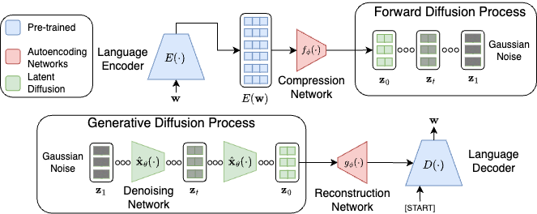

# Upstream project: Latent Diffusion for Language Generation

This repository is a fork of the official code release for [**Latent Diffusion for Language Generation**](https://arxiv.org/abs/2212.09462) by Justin Lovelace, Varsha Kishore, Chao Wan, Eliot Shekhtman and Kilian Q. Weinberger, which learns continuous diffusion in the latent space of a pretrained encoder-decoder language autoencoder. The upstream usage notes are kept below; the QQP files were removed because this study does not use them, and the ROCStories files in `datasets/` are kept for the English control.



```
@article{lovelace2024latent,
  title={Latent diffusion for language generation},
  author={Lovelace, Justin and Kishore, Varsha and Wan, Chao and Shekhtman, Eliot and Weinberger, Kilian Q},
  journal={Advances in Neural Information Processing Systems},
  volume={36},
  year={2024}
}
```

Environment, autoencoder pre-training (BART-base, ROCStories) and latent diffusion training:

```bash
conda env create -f environment.yml
python -m spacy download en_core_web_sm
./scripts/autoencoder/bart_base_roc.sh
./scripts/diffusion/bart_latent_v-pred.sh
```

Evaluation: `scripts/diffusion/eval.sh`, with `--resume_dir` set to a trained model; `num_samples`, `sampling_timesteps` and `sampler` change the sampling configuration, and `--eval_test` evaluates on the test set. The upstream code adapts implementations by [Lucidrains](https://github.com/lucidrains): [denoising-diffusion-pytorch](https://github.com/lucidrains/denoising-diffusion-pytorch), [x-transformers](https://github.com/lucidrains/x-transformers) and [flamingo-pytorch](https://github.com/lucidrains/flamingo-pytorch).
